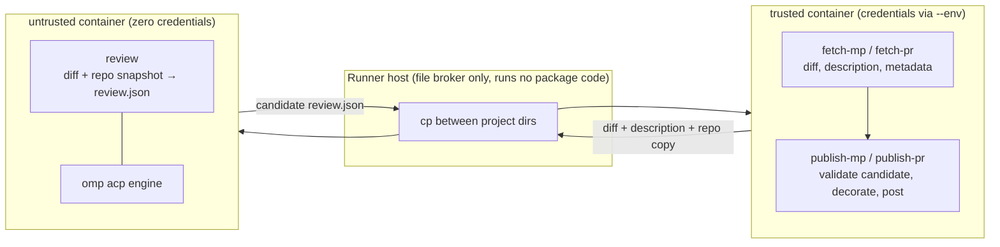

# Review pipeline: split commands, trusted/untrusted Workshops, omp over ACP

## Status and scope

This document records the target architecture of the `maas-code-reviewer`
rebuild: the composite review commands are split into `fetch-*`, `review`,
and `publish-*` commands so that the command boundary is the trust
boundary; the review step runs in an untrusted Workshop container; and the
engine is omp over ACP. `PLAN.md`, committed alongside this document, is
the authoritative implementation sequence and acceptance criteria.

Each job runs two Workshop containers on an ephemeral runner: `trusted`
(publication credentials, fetch/publish, the authoritative diff) and
`untrusted` (zero publication credentials; the agent and its tools). The
runner host acts only as a file broker between the two project directories
and runs no package code. The Python package never talks to Workshop: the
GitHub workflow — trusted because `pull_request_target` runs base-branch
code — launches both containers and brokers files between them.

omp is the only supported harness. The neutral `AgentRunner` contract is a
seam for a future switch; implementing or certifying another harness is
not part of this deliverable or its acceptance gates.

The `review` path uses the synchronous `AgentRunner` boundary, strict
terminal-JSON/full-diff validation, and an explicit operator TOML runtime
profile. The legacy composite commands (`review-mp`, `review-pr`,
`review-diff`) and the google-genai engine were retired in
PLAN.md step 16, after the workflows migrated (step 9) and the new
pipeline's parity checklist passed (step 15). There is no Gemini
fallback inside the new `review` path and no aliases pretending removed
options still work.

Design claims are not runtime security proof. Real-environment acceptance
evidence is re-collected per the plan's phase E; evidence from the prior
spike branch is historical and is not inherited.

## Goals

- Split `review-mp`/`review-pr`/`review-diff` into `fetch-mp`/`fetch-pr`,
  `review`, and `publish-mp`/`publish-pr`, so each pipeline stage runs in
  the container whose trust level matches its data.
- Run the agent only in `untrusted`, which never receives publication
  credentials; keep `fetch-*`/`publish-*` in `trusted`, which the agent
  never enters.
- Remove the application's dependency on `google-genai`; run omp over ACP
  behind the stable `review` command interface — the structured document
  out, with text rendering and GitHub/Launchpad adaptation at publish time.
- Deploy as a published Workshop SDK selected by channel, so both
  containers run the same code by construction — no per-job checkout,
  install, or artifact staging.
- Preserve existing behavior throughout the transition: duplicate-review
  detection and skip, empty-diff handling, dry runs, structured output,
  review markers, metrics, automatic and manual triggers.
- Keep publication credentials and host execution authority outside the
  agent.
- Treat generated output as untrusted and validate it against the
  authoritative diff before publication.

## Non-goals

- Rewrite the application in TypeScript or embed omp in the Python process.
- Give the agent GitHub/Launchpad publication tools, shell access,
  subagents, or an autonomous build/test/fix workflow.
- Implement or certify an alternative ACP harness in this effort.
- Retain GeminiClient as a fallback or compatibility alias; the legacy
  composite commands are a transitional bridge, not a permanent interface.
- Manage container lifecycle from the Python package: no runner, guardian,
  bootstrap, or CLI test shim exists in the package.
- Snap packaging or wheel/nightly distribution; the published Workshop SDK
  supersedes both.
- Retry/resume semantics beyond the single bounded repair round
  (PLAN.md step 17).
- Claim that Workshop defaults prevent data exfiltration or protect a
  mounted working copy from modification.
- Make every harness setting portable. Launch flags, authentication, tools,
  and system-prompt configuration necessarily have harness-specific parts.

## Assessment baseline (base revision 6c0ed73)

Historical facts about the starting state; present tense refers to that
revision, not the replacement:

- `cli.py` constructs a GeminiClient for every review command. It retains
  GitHub/Launchpad credentials and performs publication itself.
- Launchpad reviews clone the target, merge the source, and review the
  diff between `ORIG_HEAD` and `HEAD` in that merged working tree. GitHub
  reviews fetch a PR diff/description and use a caller-provided local
  checkout.
- `reviewer.py` builds Google `types.Part` prompts, performs file-boundary
  diff truncation with an omitted-file manifest, and adds the review
  marker/preamble.
- `llm_client.py` owns the Google chat, automatic tool dispatch, Google
  Search, and usage accounting.
- The model receives only repository-scoped `read_file`/`list_directory`
  callbacks, an optional `validate_review` callback, and Google Search. It
  has no shell.
- `review_schema.py` validates review shape and inline coordinates, but
  the final structured response is only parsed: validation depends on the
  model choosing to invoke `validate_review`.
- The review workflows check out untrusted PR HEAD with privileged
  workflow credentials available later in the job; their comments rely on
  never executing code from that checkout.
- The Snap is strict-confined with only `network` and `home` plugs.
- The base revision has no Workshop definition. The plan's step 1 adds a
  minimal development-only `workshop.yaml`; neither CI nor production
  review policy derives from it.

## Execution architecture

The review pipeline is split into separate commands so that the command
boundary *is* the trust boundary. Two Workshop containers per job —
`trusted` and `untrusted` — with the runner host acting only as a file
broker between their project directories:

- The agent runs only in `untrusted`, which never receives publication
  credentials. `fetch-*`/`publish-*` run in `trusted`, which the agent
  never enters; GitHub/Launchpad credentials reach those processes via
  `workshop exec --env`, never through `review`'s environment. The only
  secret entering `untrusted` is the per-run, gateway-scoped inference
  token (PLAN.md step 14), which authorizes exactly what the agent may
  do anyway.
- Both containers select the same published `maas-code-reviewer` SDK
  (pinned channel, adjacent launches), so fetch/review/publish run the
  same code by construction — no per-job checkout, install, or artifact
  staging.
- The Python package never talks to Workshop. The GitHub workflow
  (trusted — `pull_request_target` runs base-branch code) launches both
  containers and brokers files between their project directories. No
  container lifecycle code exists in the package.
- The reviewer's JSON output is a *candidate*, untrusted by construction.
  `publish-*` validates it against the authoritative diff stored in
  `trusted`'s project directory — which the agent cannot reach — before
  posting. Validation neutralizes the only tainted file crossing the
  boundary.
- Nothing in `trusted` executes from or reads the agent's checkout, and
  host git never runs against post-review files.
- The internal `review_diff` vs `review_diff_structured` split disappears:
  one internal path produces the validated structured document; text
  rendering and GitHub/Launchpad adaptation happen at output time.

### Workshop SDK versus omp SDK

Workshop's `omp` SDK installs the harness into the untrusted container.
omp's programmatic SDK embeds an agent in a Bun process; it is not required
for this design.

omp provides its own ACP server through `omp acp`. The `review` command —
running inside the untrusted container — uses the pinned
`agent-client-protocol` Python library (0.12.1) as an ACP client and spawns
`omp acp` directly with an explicit argv, cwd, and environment. Do not
introduce a custom ACP bridge or depend on an unrelated third-party omp
adapter.

### Ownership

| Component | Responsibility |
| --- | --- |
| CLI | Thin wiring: parse options, construct dependencies, print/write results. |
| Command modules | `fetch-*` (acquire diff, description, metadata; duplicate check first), `review` (produce the candidate structured document), `publish-*` (validate, decorate once, adapt, post). |
| Agent runner contract | Accept a vendor-neutral review request and return a normalized outcome (terminal text, completion status, usage with None-for-unavailable); no Google or ACP types, no callable filesystem tools. |
| ACP client | Negotiate capabilities, create one session, submit one prompt, select the terminal message, capture usage, cancel and tear down within bounds. |
| Runtime policy | Built-in defaults plus one explicit `--runtime-config` TOML override (unknown keys fail closed): exact default model and allowlist, omp argv template, tool allowlist, inference endpoint, review timeout. |
| Agent (omp, in the untrusted container) | Inspect only the provided repository and permitted external sources; return a review. |
| Publication validation | `publish-*` validates the candidate against the authoritative diff before anything is posted; decoration and platform adaptation happen here. |
| GitHub workflow (trusted control plane) | Launch both Workshops, broker files between project directories, pass credentials via `--env`, upload artifacts. |
| Runner host | File broker only; runs no package code. |

One review uses one agent process and one fresh ACP session. Do not pool
sessions or share mutable agent state between unrelated reviews. Empty
diffs short-circuit review without starting an agent or requiring model
credentials; duplicate proposals are detected by `fetch-*` before cloning,
which records a skipped status so the workflow short-circuits before
review. The runtime policy is loaded lazily: constructing it starts no
agent process.

## Review request and result

Use ordinary Python dataclasses/protocols at the application boundary. Keep the
contract small and review-specific rather than recreating a general agent SDK.

A request contains the repository path (the repo is brokered into the
container), the full diff, the bounded prompt context, description, and a
deadline. Trusted launch policy selects the harness, model, system
instructions, tools, and authentication; these must not come from the
proposed change.

`review` always produces the structured document. Use the existing
`general_comment` and `inline_comments` JSON object as the internal result
contract for every agent review; `--json-output FILE` writes the raw,
undecorated JSON, and without it human-readable text goes to stdout. The
command also accepts `--description-file` (the prompt's description input)
and `--diff-prefix` (the repository-relative prefix used to resolve inline
coordinates). Platform adaptation and decoration belong to `publish-*`:
the Launchpad comment text (every inline finding with its relative path
and line) and the GitHub review API shape (general comment plus inline
findings) are rendered from the validated document at publish time, and
the review marker/preamble is added there exactly once — deliberately
moved from the reviewer.

Required result handling:

1. Wait for the ACP prompt response; streamed progress is not a review
   result.
2. Reject cancellation, refusal, budget exhaustion, protocol failure, and
   missing output. A failed turn must never be published as a partial
   review.
3. Select the terminal review message by message identity — not thoughts,
   tool output, narration, or the first JSON-shaped object anywhere in the
   transcript.
4. Parse the selected review and validate it against the original full
   diff, never the truncated prompt or agent-modified files.
5. `publish-*` re-validates the candidate against the authoritative diff
   in the trusted project directory, decorates exactly once, renders, and
   posts. An invalid candidate exits nonzero with nothing posted. Preserve
   current empty-diff output behavior.

Do not preserve permissive transcript-wide first-object extraction. A
single JSON object, optionally wrapped in a fence, is the terminal result
contract. Invalid terminal output fails the review, subject to one bounded
repair round (PLAN.md step 17): a single re-run with the rejected output
and the full failure list marked as data, not instructions; usage summed
across attempts; `--repair-attempts 0` means single-shot; exhaustion
raises an error. Runner failures are never repaired; retry/resume
semantics beyond that round remain out of scope.

## Repository and tool behavior

Preserve the Launchpad merged-tree semantics: `fetch-mp` clones the
target, merges the source, and writes the `ORIG_HEAD..HEAD` diff; the
merged tree is left at `DIR/repo`, with `.git` excluded from anything
later copied into containers. For GitHub, `fetch-pr` fetches the diff and
description via the API with a read-only token and performs no checkout;
the workflow or operator provides the agent's repository context
separately (`actions/checkout` of the PR head into the untrusted project
directory, credentials persistence disabled, never executed host-side).
Do not silently substitute a different branch or fetch strategy, and
document that the provided context must match the reviewed revision.

Preserve file-boundary truncation and its omitted-file manifest. Make the
original full diff available as a read-only job input so the agent can
inspect changes omitted from its initial prompt. The original diff — as
stored by fetch in the trusted project directory — remains authoritative
for validation.

Use the container-native tools `read`, `grep`, `glob`, and `web_search`.
Host filesystem callbacks do not exist in the runner interface. Tool names
in prompts must match the chosen harness rather than retain `read_file` or
Google Search assumptions.

The tool policy permits repository inspection and external fact checking,
not edits, shell/Python execution, browser/computer automation, arbitrary
tasks, or interactive questions. The runtime profile sets an explicit tool
allowlist (`read,grep,glob,web_search`), turns xdev/autoqa/vault/security/
autolearn off, fixes the web role to `web/duckduckgo`, and defines a
deterministic unattended permission policy. Do not rely solely on the
harness's approval defaults.

An in-session `validate_review` MCP tool (PLAN.md step 18) is part of
the design: a newline-delimited JSON-RPC stdio server, spawned by omp
inside the container via the `review-mcp` subcommand, whose verdict comes
from the same schema validation as the host. It sees only the staged diff
and the repository file listing — no host access. It is advisory: it lets
the agent self-check before finishing, while publish-side host validation
against the authoritative diff remains the authority.

Include top-level repository conventions deliberately as untrusted task
context. Repository-provided instructions never select runtime policy.
Ambient executable/configuration discovery is disabled rather than
trusting an agent to ignore dangerous files.

## ACP integration requirements

Use the pinned Python SDK (`agent-client-protocol` 0.12.1) and its
process/connection helpers; do not implement JSON-RPC framing or
bidirectional request dispatch from scratch.

- Negotiate the protocol version and record agent identity/version.
- Do not advertise host filesystem, terminal, or interactive elicitation
  capabilities. Reject unexpected host-service requests and fail unattended
  permission requests according to the trusted policy.
- Use an absolute, clean session cwd outside the reviewed checkout; make
  the repository available at a separate path named in the task.
- Spawn the agent with an explicit argv array, cwd, and environment — no
  ambient inheritance, no shell strings, never a PTY. Keep stderr separate
  from protocol stdout.
- Serialize prompt turns; do not pipeline prompts into a busy session.
- Group text by message identity when supplied and distinguish thoughts, tool
  events, and narration. Pin and exercise the final-message selection behavior.
  ACP has no universally available explicit final-review marker.
- Wait for prompt completion before interpreting output. In the inspected omp
  source some provider errors become message text with `stopReason=end_turn`;
  that stop reason alone is not success. The validated result contract is
  mandatory, and any ambiguous error/completion behavior is a release blocker.
- On cancellation, send `session/cancel`, settle pending requests, wait a
  bounded period, then terminate the local process group.

Model selection, system-prompt installation, tool restrictions, and configuration
isolation belong to the trusted runtime profile (PLAN.md step 11). A future
harness switch may need a new profile and harness-specific checks, but those are
future work, not current acceptance requirements. Keep publication and
review-validation contracts independent of that future work.

## Security boundary

### The command boundary is the trust boundary

Split the composite review commands into `fetch-*`, `review`, and
`publish-*` so each stage runs in the container whose trust level matches
its data. `fetch-*` and `publish-*` run in `trusted` with the publication
credentials; `review` runs in `untrusted`, which never receives them. The
runner host is a file broker only: it copies files between the two
containers' project directories and runs no package code.

Everything the agent produces is untrusted data. The agent's `review`
output is a candidate, and `publish-*` validates it against the
authoritative diff in `trusted`'s project directory (unreachable by the
agent) before anything is posted; host git never runs against
post-review files. Agent-written files reach `trusted` only as that
validated candidate — the only tainted file crossing the boundary, and
validation neutralizes it. The agent never receives publication
credentials: GitHub/Launchpad credentials reach trusted processes only via
`workshop exec --env`, never through `review`'s environment; the untrusted
container has zero publication credentials, and the only secret entering
it is the per-run, gateway-scoped inference token, which authorizes
exactly what the agent may do anyway.

Nothing in the Python package launches, configures, supervises, or
disposes of containers — no runner, guardian, bootstrap, or shim exists in
the package. The only things crossing the untrusted boundary are brokered
files and per-run environment variables.

### Brokered files

The trusted container's project directory holds the authoritative inputs
(fetch writes `diff.patch`, `description.md`, and `metadata.json` and
leaves the merged tree at `DIR/repo`, with `.git` excluded from what later
gets copied) and the candidate review arrives back there for validation.
The untrusted container's project directory holds the diff, description,
repository copy, and the agent's own writes; the host `cp` moves files
between the two project directories and nothing else. The agent cannot
reach the trusted project directory, and nothing in `trusted` executes
from or reads the agent's checkout; PR-head checkout in CI has credentials
persistence disabled and is never executed host-side. The `.git` directory
is excluded from container copies, and host git never runs against
post-review files. Brokered-file discipline replaces any attempt to
protect agent-writable mounts in place: the trust boundary is the
directory split and validation, not mount flags.

### Credentials

GitHub/Launchpad credentials are secrets reserved to `trusted` and reach
those processes only via `workshop exec --env`, never through `review`'s
environment. The untrusted container receives zero publication
credentials.

The only secret entering `untrusted` is the per-run, gateway-scoped
inference token (PLAN.md step 14). The `omp-auth-gateway` snap holds the
upstream credential on the host; the runner obtains an install-time token
that is per-run on ephemeral runners (rotation on persistent hosts is by
regeneration) and passes it to the run via `--env`. The inference plug
tunnels to `127.0.0.1:4000`; the tunnel makes the agent a localhost
client, so safety comes from the issuance model, the gateway's scoping,
and route-scoped authorization — not the bind address. Verification gate:
the token authorizes exactly the inference/catalog routes omp needs — no
minting, credential export, or management routes. A narrowing proxy is
added only if that verification fails.

The gateway's upstream credential never leaves the host. Do not expose the
gateway's credential-export or management API to the container.

### Network and execution

Workshop does not filter outbound traffic, and its user has passwordless sudo.
The real boundary is the container plus its mounts, interfaces, network, and host
services, not the user ID or tool approval mode. Enable only necessary interfaces.

Provider/gateway and web-search traffic are needed; unrelated host/internal
services must not be reachable. Verify the available host-level restrictions and
document the remaining risk of outbound disclosure of review inputs. Do not
claim an egress guarantee that the deployment does not enforce.

### Privileged CI

The review workflows run untrusted PR content with privileged publication
credentials, so the trusted-code source is the base branch: the workflow
file and the `ci/` definitions come from the base branch
(`pull_request_target`), and the package code comes from the published
Store channel — the protected publish pipeline (PLAN.md step 8) is what
makes the SDK trusted. PR content is data, never tooling: no PR-supplied
Workshop definition, local SDK, action, omp extension, hook, MCP command,
dotenv file, or project settings is ever loaded as executable policy, and
PR-head checkout has credentials persistence disabled and is never
executed host-side. Ambient executable/configuration discovery is
disabled, and the verified effective settings configuration — not one
overlay file — is the evidence that the runtime policy holds.

## Budgets, failure, and cleanup

Gemini's `--max-tool-calls` is replaced by an explicit review deadline.
The runtime profile defines a positive finite default; `--review-timeout`
overrides it per run; the workflow's `timeout-minutes` is the hard
backstop.

Cancellation and timeouts must leave no running agent: send
`session/cancel`, settle pending requests, wait a bounded period, then
terminate the local process group. Phase E verifies that timeout,
cancellation, and kill during a turn leave no running omp.

Containers are workflow-owned. The package neither launches nor disposes
of them; there are no teardown steps — the ephemeral runner VM's
destruction ends both containers with it, and no per-review job state
survives on the host. The brokered files are the only job artifacts.

Failure is loud and total: an invalid candidate, timeout, or transport
error aborts the job before publish — nonzero exit, no artifact, no
comment. A dry run prints instead of posting. Duplicate proposals and
empty diffs short-circuit before an agent starts: fetch's duplicate check
runs first without cloning, and an empty diff produces known-zero metrics
without a runner.

Prefer fresh per-review environments over pooling: one agent process, one
fresh session per review. Telemetry collection failures never mask a
review failure, and cleanup never masks the primary error.

## Metrics

Metrics are a plain diff-derived summary: `review` collects host-known
metrics (diff sizes and line counts, timing, review outcome) and writes
the collected summary to `--metrics FILE`; agent identity/version and
available usage (input, output, cache, thinking, and total tokens, plus
cost and currency where the harness reports them) come from the runner.
Exact file-read counts and thinking-token splits are not guaranteed and
stay null when unavailable.

Use unavailable/null semantics for unsupported measurements, not fabricated
zeros. Distinguish unknown usage from the known zero usage of an empty-diff run.
Legacy Gemini-specific fields (resume attempts, tool-cap counts) are removed
with the legacy engine rather than renamed to different meanings.

Print ACP tool starts and subsequent parameter changes to stderr as escaped
JSON lines with the tool-call ID, human-readable title, and complete raw input.
Keep status progress, thoughts, and tool output out of this stream and keep
review stdout clean. Full parameters can disclose repository paths and search
queries, so diagnostic retention is an operator responsibility.

Optional `--otel-output DIR` complements, rather than replaces, the portable
ACP summary. A per-review Python loopback OTLP collector binds a local port
and receives omp's native traces/metrics (PLAN.md step 13); it writes
append-only `traces.jsonl` and `metrics.jsonl` OTLP JSON, preserving
integer-enum/hex-ID encoding. It accepts bounded requests and reports
collection errors without masking a primary review failure; empty/duplicate
reviews create no collector, and forced termination may lose buffered
exports. Ambient OTEL endpoint/credential configuration is not inherited.
These diagnostics remain untrusted, not publication inputs or billing proof.

Do not publish thoughts or raw tool output as reviews. Keep diagnostic output on
stderr and avoid retaining secrets or unnecessary repository content in logs.

## Deployment

The distribution is the published Workshop SDK (PLAN.md step 8): an SDK
built with sdkcraft from a locked `uv sync --frozen` environment, with the
`maas-code-reviewer` entrypoint on PATH and the packaged prompts and
`runtime/` policy resources included, resolved `__file__`-relatively on the
SDK's read-only mount. Both CI containers and operator workshops select it
declaratively by channel.

Publishing is protected: main pushes release to `latest/edge`; tags promote
to `latest/stable`. The publish workflow runs `sdkcraft pack` + upload +
release with Store credentials in CI secrets; PRs never publish. The SDK
name is registered once under the team's publisher.

Channel is the only reproducibility control: Workshop's definition format
has no SDK revision field, and this holds for the harness SDK and for our
own package alike. Promotion discipline (edge → stable after validation)
is the mitigation; rollback is re-promoting an older revision. The review
workflows pin `latest/stable`; the manual workflow gains an optional
channel input so an edge build validates a main push before promotion —
this restores a validation path, since the workflows no longer exercise
the workflow SHA's own code.

The CI deployment is the three-phase fetch → review → publish flow (PLAN.md
step 9): `review-pr.yml` (`pull_request_target`) and
`review-pr-manual.yml` (`workflow_dispatch`) launch the `ci/trusted` and
`ci/untrusted` definitions on GitHub-hosted ephemeral `ubuntu-26.04` runners
via `canonical/launch-workshop`, and the runner host only brokers files
between the two containers' project directories. The phase-B `ci/untrusted`
definition carries only the maas-code-reviewer SDK — the omp SDK and the
inference plug arrive with the engine swap (PLAN.md step 15). There are no
teardown steps: the ephemeral runner VM's destruction ends both containers.

Strict Snap packaging is retired (PLAN.md step 9), and wheel/nightly CI
distribution is superseded by the SDK. Do not silently re-confine or
reintroduce them.

Development still runs from a checkout (`uv sync`); the SDK is the
deployment artifact, and `make check` is the shared gate for both.

## Status and verification

This revision is design-first: it lands with the plan, before the code
moves (PLAN.md step 2). The plan is the authoritative implementation
sequence; each of its steps lands green under `make check` (ruff, ty, and
pytest at the unchanged 100% package coverage threshold), with CI needing
no credentials and no real container — tests use fakes, not mocks.

Status (2026-10-28, PLAN.md step 15): `review` now builds its agent process
from the trusted runtime profile and drives one ACP conversation with omp;
the terminal JSON is host-validated against the original full diff; metrics
record the agent's reported identity and usage with `None`-for-unavailable
semantics; PLAN.md step 16 then removed the legacy commands and
the google-genai engine, leaving fetch → review → publish as the only
review path.

Evidence from the prior spike branch is historical and uncommitted; none
of it is inherited as proof. Real-environment acceptance is re-collected
per the plan's phase E: a model-backed three-phase run with both
containers on the same resolved SDK revision; no publication credentials
observable in the untrusted container; the per-run gateway token verified
to authorize the inference/catalog routes omp needs and nothing else; the
effective omp tool list exactly `read,grep,glob,web_search`; agent-written
files never reaching `trusted` except as the validated candidate; publish
rejecting a forged candidate; timeout/cancellation/kill leaving no running
omp; and the ephemeral runner VM's destruction ending both containers. It
also includes an authorized live GitHub run — automatic and manual
workflow execution on a disposable private PR, with publication, dry-run
isolation, metrics artifacts, and a deliberate nonzero failure, on a
one-job ephemeral runner. Live Launchpad verification requires separate
account/test-MP access and is recorded as open rather than inferred.

Design claims are not runtime security proof; the phase E record is.

## References

- Implementation plan (committed with this document): `PLAN.md`
- ACP Python library: https://agentclientprotocol.com/libraries/python
- ACP lifecycle: https://agentclientprotocol.com/protocol/v1/overview
- ACP prompt/completion: https://agentclientprotocol.com/protocol/v1/prompt-turn
- omp ACP mode:
  https://github.com/can1357/oh-my-pi/tree/main/packages/coding-agent/src/modes/acp
- omp SDK documentation:
  https://github.com/can1357/oh-my-pi/blob/main/docs/sdk.md
- Workshop security: https://ubuntu.com/workshop/docs/security/
- Workshop lifecycle: https://ubuntu.com/workshop/docs/reference/workshops/
- sdkcraft: https://github.com/canonical/sdkcraft
