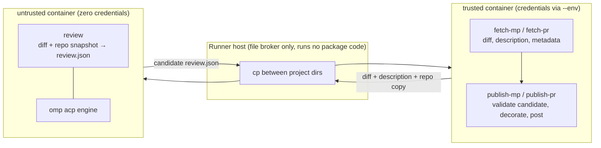

# Rebuild plan: split commands, Workshop-containerized review, omp engine

This plan rebuilds the `omp-spike` branch as a sequence of small, independently
landable commits on a fresh branch from `6c0ed73` ("base"). The spike's commits
are not logically isolated; this plan is the authoritative order.

## Architecture

The review pipeline is split into separate commands so that the command
boundary *is* the trust boundary. Two Workshop containers per job — `trusted`
and `untrusted` — with the runner host acting only as a file broker between
their project directories:



- The agent runs only in `untrusted`, which never receives publication
  credentials. `fetch-*`/`publish-*` run in `trusted`, which the agent never
  enters; GitHub/Launchpad credentials reach those processes via
  `workshop exec --env`, never through `review`'s environment. The only
  secret entering `untrusted` is the per-run, gateway-scoped inference token
  (step 14), which authorizes exactly what the agent may do anyway.
- Both containers select the same published `maas-code-reviewer` SDK
  (pinned channel, adjacent launches), so fetch/review/publish run the same
  code by construction — no per-job checkout, install, or artifact staging.
- The Python package never talks to Workshop. The GitHub workflow (trusted —
  `pull_request_target` runs base-branch code) launches both containers and
  brokers files between their project directories. No container lifecycle
  code exists in the package: no `workshop_runner.py`, `runtime_guard.py`,
  `runtime_launch.py`, or test shim from the spike.
- The reviewer's JSON output is a *candidate*, untrusted by construction.
  `publish-*` validates it against the authoritative diff stored in
  `trusted`'s project directory — which the agent cannot reach — before
  posting. Validation neutralizes the only tainted file crossing the
  boundary.
- Nothing in `trusted` executes from or reads the agent's checkout, and host
  git never runs against post-review files.
- The weird internal `review_diff` vs `review_diff_structured` split
  disappears: one internal path produces the validated structured document;
  text rendering and GitHub/Launchpad adaptation happen at output time.

## Ground rules

- One commit per step. Every step lands green: `make check` (ruff, ty, pytest
  at the unchanged 100% package coverage threshold). New code ships with its
  tests in the same commit.
- Phase A keeps the google-genai engine working throughout; the command split
  is pure refactoring plus new commands. Phase B moves `review` into a
  Workshop container with the engine unchanged. Phase C swaps the engine to
  omp over ACP. Each phase is independently useful.
- Backwards compatibility is deliberate: `review-diff`, `review-mp`, and
  `review-pr` keep working on the google-genai engine until both
  preconditions hold — the workflows migrated to the new commands (step 9)
  and the new pipeline reached feature parity (step 15 acceptance). Step 16
  performs the removal. No Gemini fallback inside the new `review` path, and
  no aliases pretending removed options still work.
- User-facing README changes ride with the step that introduces them.
- Fakes, not mocks: `FakeAgentRunner` for policy/CLI tests, a wire-level ACP
  peer for protocol tests. CI never needs credentials or a real container.
- Scope decisions (confirmed with the operator): the committed repair loop and
  the uncommitted `validate_review` MCP tool are both included, as late steps.
- Never carried over from the spike: `changes.diff`, `foo`,
  `maas-review-runs/`, `.workshop.lock`, `.claude/`, and the Workshop
  lifecycle modules listed above. `DESIGN.IMP.md` remains on the spike branch
  as its historical evidence log.

## Step overview

| # | Commit | Depends on |
| --- | --- | --- |
| 1 | chore: add workshop.yaml development environment | — |
| 2 | docs: commit revised DESIGN.md and this PLAN.md | — |
| 3 | refactor: extract review_commands.py from cli.py | — |
| 4 | feat: harden diff/inline-coordinate validation | 3 |
| 5 | feat: add fetch-mp and publish-mp commands | 3, 4 |
| 6 | feat: add fetch-pr and publish-pr commands | 3, 4 |
| 7 | feat: add the `review` command | 4 |
| 8 | build: author and publish the maas-code-reviewer Workshop SDK | — |
| 9 | ci: three-phase workflows over trusted/untrusted Workshops | 5–8 |
| 10 | feat: add vendor-neutral AgentRunner contract | — |
| 11 | feat: add review runtime policy | 10 |
| 12 | feat: add ACP conversation client | 10 |
| 13 | feat: add loopback OTLP telemetry collector | — |
| 14 | ops: per-run gateway tokens for container inference | — |
| 15 | feat: run `review` through omp over ACP | 7, 9–14 |
| 16 | chore: retire legacy commands and the google-genai engine | 9, 15 |
| 17 | feat: add bounded repair round for invalid reviews | 15 |
| 18 | feat: add in-session validate_review MCP tool | 15 |

Later work (deferred — not part of the current effort):

| # | Commit | Depends on |
| --- | --- | --- |
| 19 | docs: final README/DESIGN/AGENTS consistency pass | 9, 16 |
| 20 | feat: add review corpus collection | 15 |
| 21 | feat: add corpus replay harness and trace export | 13, 20 |
| 22 | feat: add corpus comparison report | 21 |
| 23 | docs: add BENCHMARK.md runbook | 20–22 |

## Phase 0 — preparation

### 1. chore: add workshop.yaml development environment

Add the 4-line `workshop.yaml` (`dev`, `ubuntu@26.04`, `uv` SDK) used for
developing this project inside Workshop. Explicitly a development environment;
neither CI nor production review policy derives from it.

### 2. docs: commit revised DESIGN.md and this PLAN.md

Design-first: commit the architecture documentation before the code moves.
Revise the spike's `DESIGN.md` for the three-phase command architecture —
the per-review container lifecycle, guardian, bootstrap, and shim sections
are replaced by the command-level trust boundary across the
trusted/untrusted containers and the brokered-file discipline, and the
credential section moves to per-run gateway tokens (step 14), and the
deployment section moves to the published Workshop SDK (step 8). Keep the
ACP integration requirements, and metrics policy; they still apply.

## Phase A — split the commands (google-genai engine unchanged)

Parity with base behavior is preserved throughout this phase; the composite
`review-mp`/`review-pr`/`review-diff` commands keep working until step 16 —
the workflows stop invoking them at step 9.

### 3. refactor: extract review_commands.py from cli.py

Pure move, signatures unchanged. Move `MergeProposalSummary`,
`list_merge_proposals`, `format_merge_proposals`, `has_existing_review`,
`review_merge_proposal`, PR acquisition/publication helpers, AGENTS.md context
loading, and the LP helpers (`_lp_repo_url`, `_find_last_review_date`,
`_ref_to_branch`) into `review_commands.py`. `cli.py` keeps parsing, wiring,
and output. Move the corresponding tests from `test_cli.py` into
`test_review_commands.py`. Acceptance: identical behavior; `make check`.

### 4. feat: harden diff/inline-coordinate validation

Engine-neutral validation hardening; this becomes the publish gate in steps
5–6. Gemini execution and all existing commands are untouched.

- `review_schema.py`: full diff-path state machine (`diff --git` headers,
  rename/copy targets, quoted C-style paths, CRLF, `/dev/null` sources,
  malformed-hunk recovery); keyword-only `path_prefix` and `repository_files`
  on `parse_diff_files_and_lines`/`validate_review_json`; suffix
  disambiguation against the real checkout listing with an ambiguity error
  naming `--diff-prefix`; strict rejection of unsafe inline paths (empty,
  backslash, NUL, `.`/`..`/colon segments) and non-canonical line keys; new
  `repository_files(root)` helper (`.git`-skipping walk, symlinked dirs as
  entries).
- Thread `diff_prefix`/repository listing through the existing
  `reviewer.review_diff*` validation calls; defaults preserve current
  behavior, and no existing command changes. The `--diff-prefix` CLI flag
  arrives with the new `review` command in step 7.
- Visible change: malformed coordinates that previously published now fail the
  review. Intended; call it out in the commit message.
- Tests: `test_review_schema.py` coordinate/strictness matrix, CLI wiring.

### 5. feat: add fetch-mp and publish-mp commands

Split the Launchpad halves of `review_merge_proposal` into host commands.
`review-mp` stays as the composite for now.

- `fetch-mp --output-dir DIR MP_URL`: duplicate-review check first (no clone
  on skip — record a skipped status in the output directory so workflows can
  short-circuit); clone, merge source into target, diff `ORIG_HEAD..HEAD`;
  write `diff.patch`, `description.md`, `metadata.json` (URLs, branch names,
  SHAs), and leave the merged tree at `DIR/repo` (`.git` excluded from what
  later gets copied into containers; the host keeps it for now). Accept
  Launchpad credentials from an environment variable as well as
  `--launchpad-credentials FILE`, and clone with header auth rather than any
  on-disk credential helper, so the workflow can inject credentials via
  `workshop exec --env` without writing them to disk.
- `publish-mp --review FILE MP_URL [--dry-run]`: parse and validate the
  candidate against the authoritative `diff.patch` from the fetch output
  (`--input-dir`; validation reuses step 4), render the document as the
  Launchpad comment text (every inline finding with relative path and line),
  add the review marker/preamble on the host exactly once — decoration moves
  here from the reviewer, deliberately — and post. Resolve coordinates with
  the same `--diff-prefix` `review` used (fetch records nonstandard prefixes
  in `metadata.json`). Invalid candidate: nonzero exit, nothing posted. Dry
  run prints instead of posting.
- Tests: fetch skip/clone/merge/diff against `FakeLaunchpadClient` and real
  temp git repos; publish validation-gate, rendering, marker-once, dry run,
  no-post-on-invalid.

### 6. feat: add fetch-pr and publish-pr commands

Same split for GitHub. `review-pr` stays as the composite for now.

- `fetch-pr --output-dir DIR PR_URL`: fetch the PR diff and description via
  the API (read-only token, from `--github-token` or the `GITHUB_TOKEN`
  environment variable), write `diff.patch`, `description.md`,
  `metadata.json` (owner/repo/number, base/head SHAs). No checkout: the
  workflow or operator provides the agent's repo context separately
  (`actions/checkout` in CI), so no host-side clone of the PR is introduced.
- `publish-pr --review FILE PR_URL [--dry-run]`: host-validate the candidate
  against the fetched diff (same `--diff-prefix` handling as `publish-mp`),
  adapt to the GitHub review API (general comment +
  inline findings), decorate once, post. Same failure/dry-run semantics as
  `publish-mp`.
- Tests: `FakeGitHubClient` acquisition shape, validation gate, API
  adaptation, decoration-once, no-post-on-invalid.

### 7. feat: add the `review` command

Add `review` as a new command; `review-diff` stays exactly as it is.
`review` is the pipeline-facing command: it always produces the structured
document — `--json-output FILE` writes the raw, undecorated JSON (publish
decorates); without it, human-readable text goes to stdout. New options:
`--description-file` (replicates the spike's `5118900`) and `--diff-prefix`
(exposing step 4's plumbing). Empty-diff behavior, stdin diffs (`-`),
`--repo-dir`, `--metrics`, and `--model` match `review-diff`. Internally it
shares the existing structured-review path — still the google-genai engine;
the swap happens in step 15 behind this stable command interface. Tests:
command wiring, description threading, `--diff-prefix`, JSON-vs-text modes,
empty diff, metrics.

## Phase B — move the review step into Workshop (engine unchanged)

### 8. build: author and publish the maas-code-reviewer Workshop SDK

The Workshop-native distribution, replacing per-job checkout/install: an SDK
built with [sdkcraft](https://github.com/canonical/sdkcraft) and published to
the SDK Store, selected declaratively by the CI containers and by operator
workshops alike.

- Add `sdkcraft.yaml`: a Python ≥ 3.12 runtime with the package installed
  from a locked `uv sync --frozen` environment, the `maas-code-reviewer`
  entrypoint on PATH (omp later spawns `review-mcp` from it), and the
  packaged prompts and `runtime/` policy resources included.
- Publish from protected refs only: main pushes release to `latest/edge`;
  tags promote to `latest/stable`. A publish workflow runs `sdkcraft pack` +
  upload + release with Store credentials in CI secrets; PRs never publish.
  One-time: register the SDK name under the team's publisher.
- Channel is the only reproducibility control — the definition format has no
  SDK revision field (DESIGN.md records this for omp; it now applies to our
  own package). Promotion discipline (edge → stable after validation) is the
  mitigation; rollback is re-promoting an older revision.
- The review workflows pin `latest/stable`; the manual workflow gains an
  optional channel input (`edge` validates a main push before promotion).
  This restores a validation path, since the workflows no longer exercise
  the workflow SHA's own code.
- Verify the mechanics early — this is the plan's main external unknown:
  name registration, build hooks, interface declarations, PATH entrypoints,
  and `__file__`-relative resolution of `runtime/` resources on the SDK's
  read-only mount. Gate: a smoke exec runs `maas-code-reviewer --help`
  inside a workshop using the edge SDK.
- Development still runs from a checkout (`uv sync`); the SDK is the
  deployment artifact and `make check` is the shared gate for both.

### 9. ci: three-phase workflows over trusted/untrusted Workshops

Rework `review-pr.yml` and `review-pr-manual.yml` onto ephemeral
GitHub-hosted `ubuntu-26.04` runners — Workshop installed and launched by
the `canonical/launch-workshop` action, model access via the
`omp-auth-gateway` snap — as fetch → review → publish over two
containers. Commit two definitions as separate project directories:
`ci/trusted/workshop.yaml` (the maas-code-reviewer SDK) and
`ci/untrusted/workshop.yaml` (the maas-code-reviewer SDK now; the omp SDK and
inference plug arrive in step 15) — never the dev `workshop.yaml` with its
auth tunnel and mounts. The trusted-code source shifts from the workflow SHA
to the Store channel; the protected publish pipeline (step 8) is what makes
the SDK trusted. Record that in DESIGN.md.

1. Checkout the workflow repo at the trusted SHA (provides the `ci/`
   definitions); install the `omp-auth-gateway` snap and log in with
   `GEMINI_KEY` (the upstream credential never leaves the host); read the
   install-generated gateway token; launch both Workshops (`trusted`,
   `untrusted`) via `canonical/launch-workshop`.
2. Fetch (`trusted`): `workshop run --env GITHUB_TOKEN trusted --
   maas-code-reviewer fetch-pr --output-dir /project/out …` with read-scope
   credentials.
3. Broker (host): copy the diff/description into the untrusted project dir;
   `actions/checkout` the PR head into the untrusted project dir
   (credentials persistence disabled, never executed host-side).
4. Review (`untrusted`): `workshop run untrusted -- maas-code-reviewer
   review --json-output …` with no GitHub/Launchpad credentials.
   Intermediate state: the Gemini API key is passed only to this run's
   environment — explicitly documented, safe under the base threat model (no
   code execution, repo-contained tools), replaced in step 15 by the per-run
   gateway token (step 14).
5. Broker (host): copy `review.json` back into the trusted project dir.
6. Publish (`trusted`): `publish-pr --review …` with write-scope
   credentials — validates the candidate against the authoritative diff in
   the trusted project dir before posting.
7. Upload metrics/review artifacts from the trusted project dir. No teardown
   steps: the ephemeral runner VM is destroyed after the job, taking both
   containers with it. Deliberate-failure handling (nonzero exit, no
   artifact, no post) is preserved.

Retire `snap/snapcraft.yaml` + `snap.yml`: strict confinement cannot deliver
the container side; installation is the published SDK (step 8). The legacy
`review-mp`/`review-pr`/`review-diff` commands remain available for local
rollback but are no longer invoked by any workflow; their removal waits for
step 16, once parity is proven. Preserve automatic/manual triggers, dry runs,
timeouts, and metrics artifacts. Update DESIGN.md's deployment section. The
full target workflow and container definitions are in the
[appendix](#appendix-target-workflow-definitions).

## Phase C — swap the engine to omp over ACP

### 10. feat: add vendor-neutral AgentRunner contract

`agent_runner.py`: frozen `ReviewRequest` (repo path, full diff, bounded task
prompt, system instruction, total timeout, optional model), `AgentUsage`
(None = unavailable, never fabricated zeros), `AgentRunResult` (terminal
text, `CompletionStatus`, agent identity/version, resolved model, usage), the
synchronous `AgentRunner` protocol, and the specific error hierarchy
(configuration, startup, transport, timeout, cancelled, refused, limit,
result). No Google/ACP types. Add `tests/fake_agent_runner.py` (scripted
outcomes, recorded requests) and point `test_fakes.py` at it.

### 11. feat: add review runtime policy

A small `runtime_config.py` — much smaller than the spike's, since no
Workshop definition, container paths, socket, or shim configuration exist.
Built-in defaults plus one explicit `--runtime-config FILE` TOML override
(stdlib `tomllib`, unknown keys fail closed): exact default model and
allowlist, omp `acp` argv template (argv arrays, never shell strings),
packaged `runtime/profile/policy.yml` (native tool allowlist
`read,grep,glob,web_search`; xdev/autoqa/vault/security/autolearn off;
`modelRoles.web: web/duckduckgo`), inference endpoint, positive finite review
timeout. Lazy: loading starts no process. Tests: `test_runtime_config.py`.

### 12. feat: add ACP conversation client

`acp_client.py` on the pinned `agent-client-protocol==0.12.1` SDK (add the
dependency). `AgentProcess` (explicit argv/cwd/env/session_cwd; no ambient
inheritance) and `run_acp(process, request, *, deadline)`: initialize without
host filesystem/terminal/elicitation capabilities, one fresh session with a
clean absolute cwd, one serialized prompt, terminal-message selection by
message identity, usage capture, deterministic unattended permission policy,
provider-error-with-`end_turn` rejection, bounded cancel/settle/teardown of
the local process group. Tests: `tests/fake_acp.py` wire-level scripted peer
+ `test_acp_client.py` (progress/thought/tool JSON never becomes the result,
EOF/malformed frames, backpressure, shutdown).

### 13. feat: add loopback OTLP telemetry collector

`telemetry.py`: `TelemetryCollector` context manager binding loopback;
bounded Content-Length/chunked handling; protobuf-validated OTLP JSON
appended to `traces.jsonl`/`metrics.jsonl`; collection errors never mask a
review failure. Add `opentelemetry-proto`. Inert until step 15 wires
`--otel-output`. Tests: `test_telemetry.py` (real HTTP/protobuf round trips).

### 14. ops: per-run gateway tokens for container inference

No package code — a deployment pattern plus a verification gate.

The host runs the `omp-auth-gateway` snap (a wrapper around `omp
auth-gateway`), which holds the real upstream provider credentials. The snap
generates a token at install time, valid only for the gateway itself;
`sudo omp-auth-gateway token` prints it. In CI the runner is an ephemeral
VM, so install-time generation is equivalent to per-run issuance — the token
dies with the job. On persistent hosts (the benchmarking VM), rotate by
regenerating it via the snap. The untrusted Workshop definition's inference
plug tunnels to the gateway (127.0.0.1:4000) directly, and the token reaches
the review run via `--env`. The agent reading it is acceptable: it
authorizes only what the agent may do anyway. (Note: localhost binding alone
does not keep the token from the agent — the tunnel makes the agent a
localhost client. The safety comes from install-time/per-run issuance,
gateway scoping, and route-scoped authorization, not the bind address.)

Gate for step 15's deployment, recorded in phase E: enumerate what the
per-run token class authorizes on the gateway. It must permit the
inference/catalog routes omp needs and nothing else — no token minting, no
upstream-credential export, no management routes. If verification fails,
reinstate a narrowing proxy in front of the gateway (the spike's
`scripts/review_inference_proxy.py` + `maas-review-inference.service` are
the reference implementation) or fix the gateway before proceeding.

### 15. feat: run `review` through omp over ACP

The engine swap, confined to the `review` command — fetch/publish and the
legacy commands (still Gemini-backed until step 16) are untouched:

- `reviewer.py`: the `review` path takes `runner: AgentRunner | None`;
  terminal-message JSON parsed and validated against the original full diff
  before output; JSON envelope prompt (`diff`/`diff_paths`/`description`/
  `repository_conventions`, marked untrusted); file-boundary truncation with
  omitted-file manifest; empty diff short-circuits with known-zero metrics
  and no runner; `runner=None` on a nonempty diff raises `RunnerResultError`.
  The Gemini-backed functions serving the legacy commands stay until
  step 16 — the two engine paths coexist for exactly one step.
- The `review` handler builds an `AgentProcess` from the runtime profile
  (scrubbed env; only the gateway token by name) and calls `run_acp`. No
  container-management code in the package. `review` drops
  `-g/--gemini-api-key-file` and gains `--runtime-config`,
  `--review-timeout`, and `--otel-output` (wiring the step-13 collector).
- Prompts: rewrite `shared_instruction.md`, `structured_instructions.md`,
  `structured_system_instruction.md` for native read/grep/glob/web_search
  tools, relative coordinates in the full diff, one fenced-or-bare terminal
  JSON object, no `validate_review` requirement. The legacy free-text
  prompts (`instructions.md`, `system_instruction.md`) stay until step 16;
  legacy commands keep working, though their shared prompt wording now
  describes native tools — a one-commit regression, and nothing in CI
  invokes them anymore.
- `metrics.py`: add agent name/version, cache/thinking/total tokens, cost
  and currency with `None`-for-unavailable semantics, populated by the new
  path; the legacy fields stay populated by the legacy path and are removed
  in step 16.
- The untrusted CI Workshop definition gains the omp SDK and the inference
  plug to the host gateway; the workflow passes the install-generated
  gateway token (step 14) to the review run's environment, replacing the
  Gemini key.
- README: `review` command reference and runtime configuration. AGENTS.md
  and DESIGN.md: status update noting legacy retirement is still pending.
- Tests: the `review` path is rewritten against `FakeAgentRunner`; legacy
  command tests are untouched and keep passing.

Acceptance: parity checklist for the fetch/review/publish pipeline — dry
runs, JSON/text output, duplicate/empty skips, metrics files — plus
`make check`, with legacy commands still passing their existing tests.

### 16. chore: retire the legacy commands and the google-genai engine

Preconditions, both met at this point: the workflows have used the new
commands since step 9, and step 15's acceptance established parity. Remove:

- The `review-mp`, `review-pr`, and `review-diff` commands and their tests;
  the documented local/CI flow is fetch → review → publish.
- `llm_client.py`, `tests/fake_llm.py`, `tests/test_llm_client.py`;
  `google-genai` from `pyproject.toml`; regenerate `uv.lock`.
- The legacy free-text prompts (`instructions.md`, `system_instruction.md`).
- `repo_tools.py`'s `read_file`/`list_directory` agent callbacks (keep
  host-only `read_agents_md`) and the legacy metrics fields (`files_read`,
  `tool_call_limit*`, `resume_attempts`).
- README: remove legacy command references; add migration notes for
  `-g/--gemini-api-key-file` and `--max-tool-calls` (replaced by
  `--runtime-config`/`--review-timeout`).

### 17. feat: add bounded repair round for invalid reviews

Replicates spike commit `caa430c`. `--repair-attempts` (default 1, 0 =
single-shot): when the terminal document fails validation, re-run once with
`_repair_prompt` (rejected output + full failure list, marked as data, not
instructions); usage summed across attempts; exhaustion raises
`RunnerResultError` with combined usage. The spike's DESIGN.md no-retry
stance is deliberately superseded — record that in the commit message and
DESIGN.md. Tests: repair accepted once, usage summing, exhaustion,
zero-attempts single-shot, runner failures never repaired.

### 18. feat: add in-session validate_review MCP tool

Lands the spike's uncommitted work, made consistent:

- `review_mcp.py`: newline-delimited JSON-RPC stdio server exposing one
  `validate_review` tool whose verdict comes from
  `review_schema.parse_review_document`; sees only the staged diff and the
  repository file listing; no host access.
- `review_schema.py`: add `parse_review_document` (fence handling, non-JSON
  constant rejection, then `validate_review_json`), shared by host and tool.
- `agent_runner.py`: `ReviewRequest.mcp_servers`; `acp_client.py`: map to
  `McpServerStdio` at `session/new`.
- `reviewer.py`: stage the diff at `.maas-code-reviewer/review-input.diff`
  next to the repo, attach the server descriptor, clean up in `finally`.
  Advisory only: publish-side host validation remains the authority.
- `cli.py`: `review-mcp` subcommand (`--diff-file`, `--diff-prefix`,
  `--repo-dir`) — omp spawns it inside the container.
- Prompts: add the validate_review paragraph to `structured_instructions.md`
  and fix the spike's contradiction — `structured_system_instruction.md` must
  no longer claim no validation tool is exposed.
- Tests: `test_review_mcp.py` (protocol, verdicts, malformed input), reviewer
  staging/cleanup and prefix pass-through, ACP `mcp_servers` mapping.

## Later work — final docs and benchmarking (deferred, not scheduled)

The remaining steps are not part of the current effort; numbering continues
for stable reference. Per-step documentation rides with each landed step
meanwhile, so step 19 is a sweep rather than a prerequisite, and the
benchmarking steps stand up the model-comparison tooling when it is wanted.

### 19. docs: final README/DESIGN/AGENTS consistency pass

Real Workshop host setup, CI definition provenance, omp-auth-gateway and
per-run token setup (step 14), SDK distribution (step 8), the
fetch/review/publish local flow, the trusted/untrusted security boundary,
metrics schema. Verify no stale Gemini/legacy-command/nested-container
wording remains.

### 20. feat: add review corpus collection

`scripts/collect_reviews.py` (stdlib only): immutable corpus from the last N
landed `canonical/maas` commits — merged-PR diffs/descriptions, bot baselines,
human reviews; write-once manifest (schema v2); bare `repository.git` cache;
tokens via env only. Extend Makefile lint/typecheck/format to `scripts/`
(its first addition there). Tests: `test_collect_reviews.py`.

### 21. feat: add corpus replay harness and trace export

`scripts/replay_reviews.py`: per case×model, `git worktree` checkout and the
installed `maas-code-reviewer review` subprocess (`--description-file`,
`--diff-prefix b/`, `--json-output`, `--metrics`, `--otel-output`);
credential-scrubbed env; parallel resumable attempts; validates output
against the diff and the requested model; exports annotated traces. Runs
directly on the disposable benchmark VM (the VM is the boundary — documented
in BENCHMARK.md). Add `src/maas_code_reviewer/otel_export.py`
(`annotate_traces`, `TraceExporter`) — the only in-package piece, imported by
the replay script. Tests: `test_replay_reviews.py` (fake reviewer executable,
fake OTLP receiver), `test_otel_export.py`.

### 22. feat: add corpus comparison report

`scripts/compare_reviews.py` (stdlib only): deterministic single-file HTML
report — wall time from the `invoke_agent` root span, tokens/cost from
metrics, statuses, comment counts beside baselines, optional LLM-classified
issue tables. Tests: `test_compare_reviews.py`.

### 23. docs: add BENCHMARK.md runbook

The end-to-end runbook (VM setup, runtime profile allowing every
gateway-advertised model via the host gateway with a benchmark-scoped token,
Langfuse env, collect → replay → compare), including the MCP-validation note
from the spike's uncommitted BENCHMARK.md hunk.

## Phase E — real-environment acceptance (evidence, not commits)

Before the new branch replaces the spike, re-collect rather than inherit the
spike's proof:

1. Real Workshop host: the three-phase flow completes a model-backed review
   with both containers running the same published SDK revision (record the
   resolved SDK identity at launch); no publication credentials observable
   in the untrusted container (`env`, filesystem,
   `/proc` probes); the only secret present there is the per-run gateway
   token, verified to authorize the inference/catalog routes omp needs and
   nothing else (no token minting, credential export, or management routes);
   effective omp tool list exactly `read,grep,glob,web_search`;
   files written by the agent never reach the trusted container except the
   validated candidate; publish rejects a forged candidate; timeout/
   cancellation/kill during the turn leave no running omp; the ephemeral
   runner VM's destruction ends both containers (no explicit teardown
   steps).
2. Authorized live GitHub run: automatic and manual workflow execution on a
   disposable private PR, including publication, dry-run isolation, metrics
   artifacts, and a deliberate nonzero failure, on a one-job ephemeral runner.
3. Launchpad live verification still requires separate account/test-MP
   access; record it as open rather than inferred.

## Explicitly out of scope

- Alternative ACP harnesses (the neutral contract is a seam, not a
  deliverable).
- Snap packaging (retired in step 9, not silently re-confined).
- Wheel/nightly CI distribution (`wheel.yml`, `nightly.yml`,
  `scripts/build_simple_index.py`) — superseded by the Workshop SDK
  (step 8); revisit only if a non-Workshop distribution is ever needed.
- Container lifecycle management in the Python package (workshop_runner,
  runtime_guard, runtime_launch, shim) — replaced by workflow/operator-owned
  containers.
- The spike's scratch files (`changes.diff`, `foo`, `maas-review-runs/`,
  `.workshop.lock`, `.claude/`).
- Retry/resume semantics beyond the single bounded repair round of step 17.
- The narrowing inference proxy (`scripts/review_inference_proxy.py` and its
  systemd unit) — superseded by per-run, route-scoped gateway tokens
  (step 14); reinstated only if the token-scope verification fails.

## Appendix: target workflow definitions

The final (post-step-15) shape, owned by step 9. Everything here runs from
trusted sources: the workflow file and `ci/` definitions come from the base
branch, and the package comes from the published SDK. PR content enters only
as files in the untrusted project directory.

### Container definitions

```yaml
# ci/trusted/workshop.yaml
name: trusted
base: ubuntu@26.04
sdks:
  - name: maas-code-reviewer
    channel: latest/stable
```

```yaml
# ci/untrusted/workshop.yaml
name: untrusted
base: ubuntu@26.04
sdks:
  - name: maas-code-reviewer
    channel: latest/stable
  - name: omp
# Inference access: the container reaches the host's omp-auth-gateway
# (127.0.0.1:4000) through an interface plug; exact syntax per the Workshop
# definition reference, validated in step 9.
```

Phase-B intermediate (step 9 as landed): the untrusted definition omits the
`omp` SDK and the inference plug until step 15 adds them.

### `review-pr.yml` — automatic review

```yaml
# Trusted code only: workflow and ci/ definitions from the base branch,
# package from the published SDK. PR content is data, never tooling.
name: Review pull request

on:
  pull_request_target:
    types: [opened]

permissions:
  contents: read
  pull-requests: write  # exercised only by the publish step

jobs:
  review:
    runs-on: ubuntu-26.04  # GitHub-hosted ephemeral VM
    timeout-minutes: 30
    steps:
      - name: Check out the trusted workflow revision
        uses: actions/checkout@v6
        with:
          ref: ${{ github.workflow_sha }}  # ci/ definitions, never the PR

      - name: Install and log in the omp-auth-gateway
        env:
          GEMINI_KEY: ${{ secrets.GEMINI_KEY }}
        # The snap wraps `omp auth-gateway`; login hands it the upstream
        # Gemini credential, which never leaves the host.
        run: |
          sudo snap install omp-auth-gateway
          sudo GEMINI_KEY="$GEMINI_KEY" omp-auth-gateway login

      - name: Read the per-run inference token
        id: inference
        # Step 14. The snap generates the gateway-scoped token at install
        # time; the runner is an ephemeral VM, so install-time == per-run.
        # It authorizes inference routes only and dies with the job.
        run: echo "token=$(sudo omp-auth-gateway token)" >> "$GITHUB_OUTPUT"

      - name: Prepare job project directories
        run: |
          mkdir -p ~/review
          cp -r ci/trusted ~/review/trusted
          cp -r ci/untrusted ~/review/untrusted
          mkdir -p ~/review/untrusted/inputs ~/review/untrusted/outputs \
                   ~/review/trusted/in

      - name: Launch the trusted Workshop
        uses: canonical/launch-workshop@v1
        with:
          project: ~/review/trusted
          workshop: trusted

      - name: Launch the untrusted Workshop
        uses: canonical/launch-workshop@v1
        with:
          project: ~/review/untrusted
          workshop: untrusted

      - name: Fetch the PR (trusted)
        env:
          GITHUB_TOKEN: ${{ secrets.GITHUB_TOKEN }}
        run: |
          workshop run --env GITHUB_TOKEN trusted -- \
            maas-code-reviewer fetch-pr \
              --output-dir /project/out \
              "${{ github.event.pull_request.html_url }}"

      - name: Stage review inputs (host broker)
        run: >
          cp ~/review/trusted/out/diff.patch
             ~/review/trusted/out/description.md
             ~/review/untrusted/inputs/

      - name: Check out the PR head as disposable agent context
        uses: actions/checkout@v6
        with:
          ref: ${{ github.event.pull_request.head.sha }}
          path: pr-head
          persist-credentials: false

      - name: Move the checkout into the untrusted project
        run: mv pr-head ~/review/untrusted/repo

      - name: Review (untrusted)
        env:
          GATEWAY_TOKEN: ${{ steps.inference.outputs.token }}
        run: |
          # No GitHub/Launchpad credentials here, by design.
          # Phase-B intermediate: pass GEMINI_API_KEY via --env instead.
          workshop run --env GATEWAY_TOKEN untrusted -- \
            maas-code-reviewer review \
              --repo-dir /project/repo \
              --diff-file /project/inputs/diff.patch \
              --description-file /project/inputs/description.md \
              --review-timeout 600 \
              --json-output /project/outputs/review.json \
              --metrics /project/outputs/metrics.json

      - name: Collect the candidate review (host broker)
        run: >
          cp ~/review/untrusted/outputs/review.json
             ~/review/trusted/in/review.json

      - name: Publish the review (trusted)
        env:
          GITHUB_TOKEN: ${{ secrets.GITHUB_TOKEN }}
        run: |
          # Re-validates the candidate against the authoritative diff in
          # ~/review/trusted/out before anything is posted.
          workshop run --env GITHUB_TOKEN trusted -- \
            maas-code-reviewer publish-pr \
              --review /project/in/review.json \
              --input-dir /project/out \
              "${{ github.event.pull_request.html_url }}"

      - name: Collect artifacts
        if: always()
        run: >
          mkdir -p artifacts && cp
             ~/review/untrusted/outputs/metrics.json artifacts/ || true

      - name: Upload metrics artifact
        if: always()
        uses: actions/upload-artifact@v4
        with:
          name: review-metrics
          path: artifacts/
```

No teardown step: the GitHub-hosted runner is an ephemeral VM, so both
Workshops are destroyed with it. A failing review step (invalid candidate,
timeout, transport error) aborts the job before publish: nonzero exit, no
artifact, no comment. Deadlines are the CLI's `--review-timeout` inside the
container with the job's `timeout-minutes` as the hard backstop.

### `review-pr-manual.yml` — dispatched review

Same job shape, with the trigger and input plumbing changed:

```yaml
on:
  workflow_dispatch:
    inputs:
      pr_url:
        description: Pull request URL
        required: true
      model:
        description: Exact model identity allowed by the runtime profile
        required: false
      review_timeout:
        description: Total review deadline in seconds
        default: "600"
      sdk_channel:
        description: maas-code-reviewer SDK channel (edge validates main)
        default: latest/stable
      dry_run:
        description: Run the review but do not publish
        type: boolean
        default: false
```

Deltas against the automatic job: `fetch-pr`/`publish-pr` take
`${{ inputs.pr_url }}`; the review exec adds `--model "${{ inputs.model }}"`
when set, `--review-timeout ${{ inputs.review_timeout }}`, and a matching
job `timeout-minutes`; the
launch step rewrites the copied definitions' `channel` when `sdk_channel`
differs; the publish step adds `--dry-run` when requested; a
`pull_request_target`-style PR head checkout uses the URL's owner/repo.
